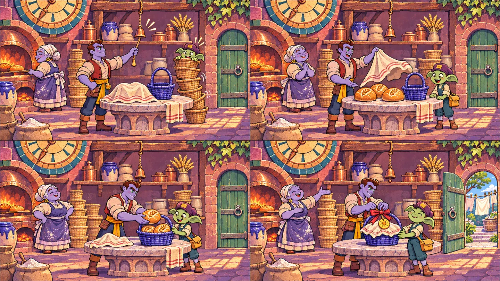
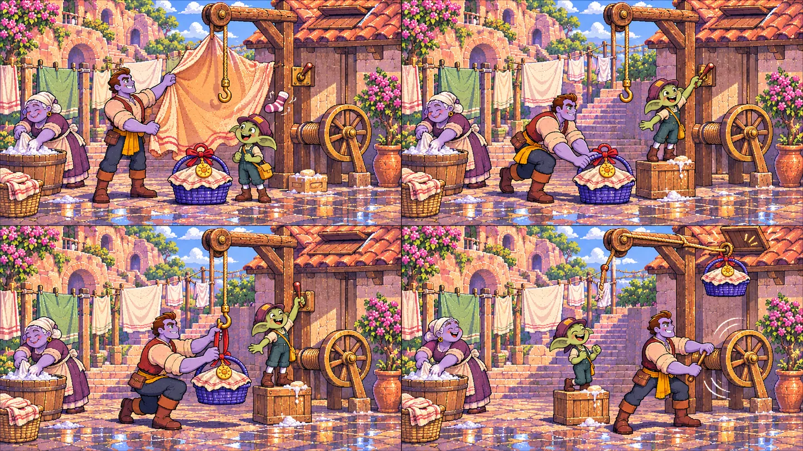
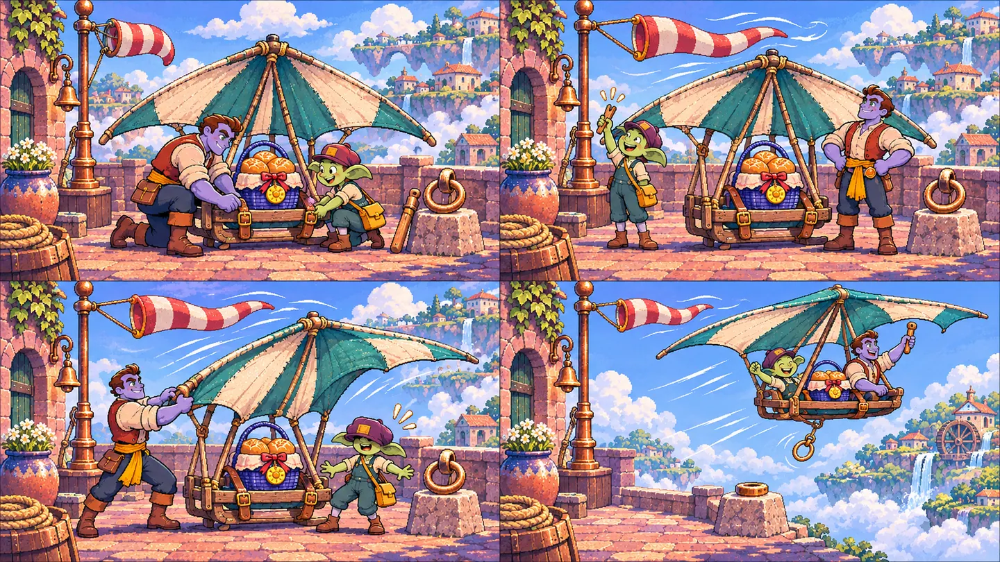
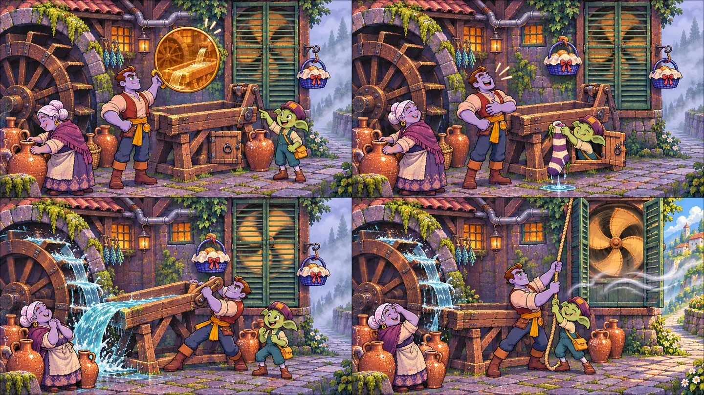
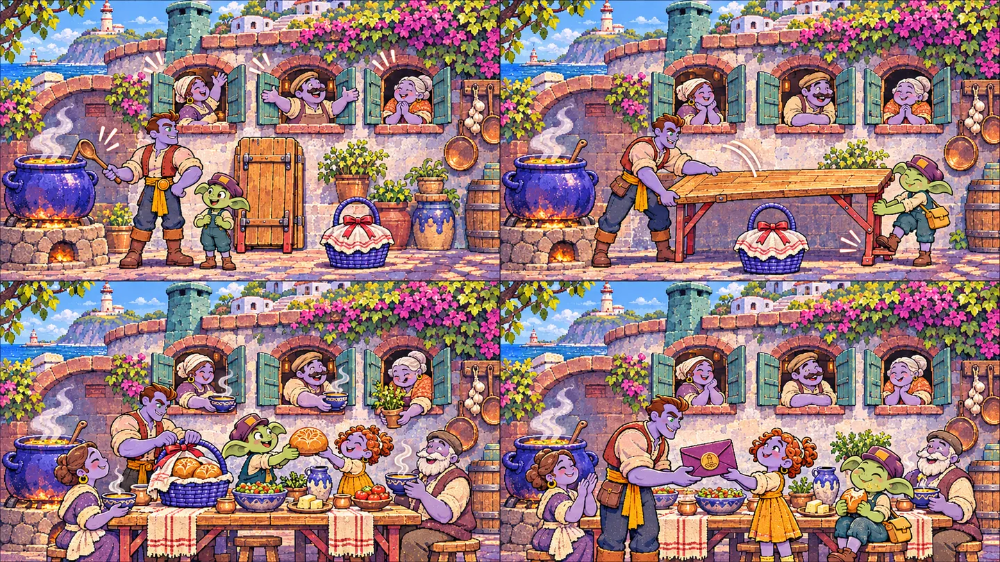

# Почта Нижнего острова

Игровая глава Tvijo после «Замка пропущенного часа». Экипаж открыл переход в прошлое. Гуманоид помог принцессе-часовщице запустить часы. Теперь внизу его родичи снова слышат полдень и ждут хлеб. Местный почтальон, гоблин Шпуль, впервые ведёт доставку сам. Гуманоид берётся сопровождать его. Встреча с принцессой и полёт рейнджеров происходят до начала этой главы.

[Играть в браузере](https://tvijo-crew-academy.be9ava.chatgpt.site/mailrun.html) · [Вернуться в штаб](https://tvijo-crew-academy.be9ava.chatgpt.site/#hq)

Всего пять широких локаций. На художественном листе четыре состояния читаются слева направо, сверху вниз. В игре одно состояние занимает весь кадр. Номера 1–20 относятся к действиям этой главы.

Гуманоид узнаваем по синей коже, каштановому чубу и янтарной линзе на кушаке. Здесь на нём льняная рубаха и рабочий жилет. Шпуль — небольшого роста, с большими круглыми ушами, в сливовом колпаке с заплатой и с горчичной почтовой сумкой. Пекарка и мельничиха — родичи Гуманоида. Предмет, который игрок узнаёт в каждой комнате, — синяя корзина с караваями.

## 1. Пекарня под часами

Часы в замке снова пробили полдень. Пекарка высунулась из-за печи. «Три каравая стынут, а почтальон куда-то провалился!»

| Действие | Что видит и слышит игрок |
|---|---|
| 1. Дёрнуть шнур звонка | Шпуль вынырнул из корзин. «Я проверял, у какой дно крепче!» |
| 2. Поднять полотенце | Из-под полотенца вырвалось тёплое облако. На всех трёх корочках отпечатан колос. |
| 3. Уложить три каравая в синюю корзину | Шпуль пересчитал караваи и сунул нос в корзину. «До обеда придётся дотерпеть». |
| 4. Взять бирку из сумки Шпуля и привязать красную петлю | Красная петля держит бирку-солнце. Пекарка распахнула дверь. «Теперь груз узнают на любой крыше». |

## 2. Двор прачки

Прачка учит простыни ловить ветер. Корзину нужно поднять на крышу, а подъёмник исчез за бельём.

| Действие | Что видит и слышит игрок |
|---|---|
| 5. Отодвинуть большую простыню | За простынёй качнулся крюк. Один полосатый носок подхватило ветром. Прачка погрозила небу прищепкой. |
| 6. Подвинуть ящик к тормозу | Ящик заскрипел, зато Шпуль теперь держит рычаг обеими руками. «Можно грузить!» |
| 7. Зацепить красную петлю за крюк | Красная петля натянулась. Караваи остались под полотенцем, даже когда Шпуль чихнул. |
| 8. Повернуть ворот, пока Шпуль держит тормоз | Корзина прошла над черепицей. Прачка снизу считает обороты, Шпуль сверху считает караваи. |

## 3. Крыша ветровой почты

Крыши соединяет ветровая почта. Свой планер Шпуль сшил из старого навеса: полоска к полоске, ни одной одинаковой заплаты.

| Действие | Что видит и слышит игрок |
|---|---|
| 9. Затянуть грузовые ремни | Ремни затянуты. Шпуль проверил пряжку и уже в третий раз пересчитал хлеб. |
| 10. Снять прищепку с ветроуказателя | Прищепка освободила полосатый рукав. Он вытянулся вправо, к белому туману. |
| 11. Повернуть крыло по ветру | Парус надулся. Колпак Шпуля съехал ему на глаза. «Курс вижу. Дорогу пока не очень!» |
| 12. Вынуть причальный штырь | Крыша осталась под ногами. У мельницы туман такой густой, что даже лопасти кажутся из ваты. |

## 4. Мельница тумана

Мельничиха собирает росу в кувшины для чая. Колесо сухое, вентилятор стоит, а за ставнями в тумане потерялась дорога.

| Действие | Что видит и слышит игрок |
|---|---|
| 13. Поднять янтарную линзу | В янтарном круге течёт вчерашняя вода. В настоящем она останавливается у узкого лючка под жёлобом. |
| 14. Отправить Шпуля в лючок | Из лючка показались уши, потом руки с мокрым носком. «По ветру прибыло. Обратно пешком потащим!» |
| 15. Направить жёлоб на колесо | Первая струя толкнула колесо. За зелёными ставнями зашелестели холщовые лопасти вентилятора. |
| 16. Распахнуть ставни вентилятора | Ставни распахнулись. Туман скатился с тропы, и из-за последней крыши потянуло горячим супом. |

## 5. Длинный стол

На Нижнем острове варят один котёл на три дома. Тот, кто принёс хлеб, зовёт всех к столу.

| Действие | Что видит и слышит игрок |
|---|---|
| 17. Позвать семьи ударом ложки по котлу | Ложка ударила по синему котлу, и сразу открылись три окна. Каждая семья ждала знакомого звука. |
| 18. Разложить стол, пока Шпуль подставляет ножку | Гуманоид опустил столешницу, Шпуль пяткой поставил ножку на место. Стол даже не качнулся. |
| 19. Развязать корзину и поделиться караваями | Все три каравая нашли свой дом. В ответ на столе появились суп, зелень и кусочек сыра для Шпуля. |
| 20. Принять у девочки обратное письмо | Девочка вручила фиолетовое письмо. Шпуль разглядел печать: под волной светит маяк. «А вот туда я ещё почту не носил…» |

## Возвращение

После действия 14 карта помечает двор прачки. Там можно вручить найденный носок хозяйке. Она привешивает пару одной прищепкой, на её верёвке появляются оба носка. Возврат к текущей доставке работает из карты. Повтор комнаты сохраняет полное продвижение. Печать с маяком под волной остаётся последним кадром главы и зацепкой для следующих двадцати действий.

## Управление

Мышь и касание работают по предметам в сцене и по кнопкам с их названиями. Стрелки и Tab выбирают предмет, Enter или E применяет его. Esc открывает маршрут. Телефон удобнее держать горизонтально. Шаг, открытые комнаты и возврат носка сохраняются в localStorage текущего браузера.

## Материалы для разработки

Файлы игры находятся в web/mailrun.html и web/mailrun/. Персонажи и обстановка нарисованы для Tvijo. Пять файлов WebP служат одновременно раскадровкой и кадрами игры. Данные двадцати действий и реплики для побочных предметов находятся в scenes.js.

Тест этой главы выполняется командой `node --test tests/mailrun.test.mjs`. Сборка Sites использует обычную команду проекта `node tools/build.mjs`.
