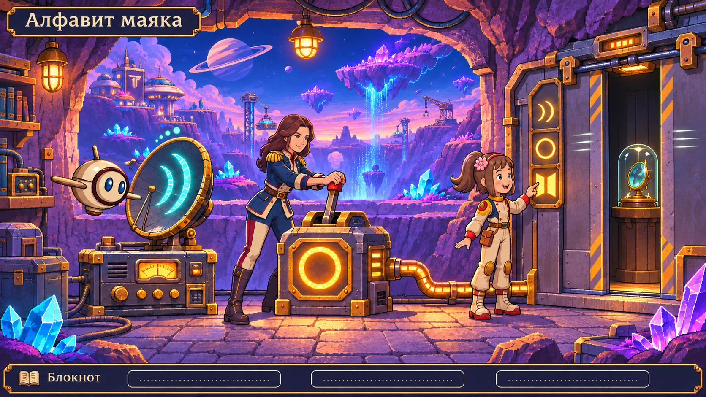

# Как проектировать игровые сцены Академии

## 1. Одна сцена — один понятный вопрос

Сформулируй, что игрок увидит, что попробует и как поймёт результат. В M1 это простой вопрос «Как перебраться за капсулой?». В первые секунды покажи обесточенную переправу и капсулу либо заметное направление к ней, если телефон обрезает сцену. На первом экране должно быть понятно, где действовать. Длинную версию задания оставь в сворачиваемом описании. Три секунды на понимание цели — гипотеза для наблюдения.

## 2. Характер через реакцию на один объект

Для новой сцены набросай три разных реакции. Одна меняет мир, вторая помогает заметить закономерность, третья даёт повод улыбнуться и попробовать снова. Например, Робот ставит мост на опоры, Самолётик освещает пустое гнездо защёлки, Капитан притягивает магнитом к ботинку один потерянный болт. Ошибочная гипотеза оставляет путь к решению открытым. Проверяй, что импровизации подходят роли героя. Мимика, одежда, силуэты и четыре принятые позы служат образцом. Для M1 достаточно читаемой реакции Робота.

## 3. Видимое последствие и доступное управление

У приказа должна быть физически понятная развязка. Например, загорается опора, секции моста сходятся, герой может ступить на настил. При отключённом звуке изменение видно по движению или форме, а при сниженной анимации — по конечному состоянию. Текст ответа остаётся в рации. Следи, чтобы всплывающие эффекты не заслоняли капсулу, подсказку E и касание. Озвучивание и вибрация — дополнения, зависящие от выбора игрока и устройства. Движение и прыжок доступны двум пальцам, короткая головоломка — одним пальцем или мышью.

## 4. Пара героев и порядок действий

Используй разные знания или способности двух героев. В Разломе Самолётик выясняет частоту, Ассистентка даёт питание, Дочка ждёт оба результата. Два независимых действия принимаются в обоих порядках. Если торопливый игрок сразу выбирает шлюз, реакция должна показать, какой сигнал отсутствует. Для короткого дополнительного испытания можно предложить синхронный рычаг и платформу. Дай игроку увидеть цикл, повторить попытку и при желании вернуться на основной маршрут.

## 5. Сцена, короткий пазл и возвращение

Сохраняй единый космический квест. В следующих выпусках одно знакомое препятствие может вести в один короткий пазл на одном экране. Выбери одну новую механику на комнату, придумай, что меняется в основной сцене после решения. Например, Робот передвигает энергоячейку на плиту, а на прежнем экране зажигается тёмная ветка конвейера. Для пошаговых задач предусмотрены «Шаг назад», повтор с начала и возврат в сцену с сохранением уже пройденного пути. Сразу проверь обе ориентации и ошибку на последнем шаге. Целевые 30–60 секунд для одного пазла ещё предстоит проверить на людях.

## 6. Следующий эксперимент — «Иероглифы Центавры»

После проверки M1 предложи отдельную необязательную комнату «Алфавит маяка» в Кристальном разломе. Три метки на пульте изображают две дуги, кольцо и створки. Игроку доступны слова «слушать», «питать» и «открыть».

На кадре оба сигнала уже поданы. Две дуги на антенне отзываются на эхо, от кольца к шлюзу тянется светящийся кабель, а в просвете между створками видна линза под стеклом. Три поля Блокнота пока пусты. В игровой комнате линзу можно будет взять после проверки догадки. Вернувшись в Разлом, игрок увидит линзу в инвентаре и пустую нишу при повторном входе.

| Наблюдение на сцене | Что можно вывести и проверить |
|---|---|
| По просьбе игрока Самолётик принимает эхо. Две дуги пульсируют в такт трём ответным импульсам | Сопоставить дуги со словом «слушать» |
| Ассистентка подаёт питание. Загораются кабель и кольцо, створки ещё закрыты | Сопоставить кольцо со словом «питать» |
| Когда частота и питание готовы, Дочка касается третьей метки, и створки расходятся | Проверить значение «открыть» действием |

В Блокноте игрок касается знака, затем выбирает значение. Одна неверная догадка оставляет улики на экране. Игрок может изменить запись и проверить её ещё раз. При верной подаче двух сигналов открывается боковая ниша с линзой связи. Проверь решение в двух порядках, раннее открытие, исправление неверного перевода и возвращение из комнаты. В парном варианте разведчик видит символ, а инженер — показания приборов. Для одиночной тренировки роли второго пилота выполняет экипаж. Это описание предлагаемой комнаты.

## 7. Очередь механик

| После пилота | Сцена Академии и опыт игрока |
|---|---|
| Первая следующая проба | «Алфавит маяка» и Блокнот. Спросить игрока, какая улика подсказала значение |
| Следом, если захочется ещё одного типа пазла | «Склад Робота». Передвинуть энергоячейку на плиту и увидеть, какой конвейер ожил. Позже тот же груз могут переносить маленькие ремонтные дроны с разными ролями |
| Дальнейшие оригинальные модули | Расследование застывшей аварии по уликам. Особняк с выбором комнаты и фазами «Прошлое / Настоящее». Цепная реакция зеркал и реле. Сборка моста из поворачиваемых секций. Поле кристаллических аномалий с числовыми подсказками. Лабиринт со сбором сфер. Отражение резонансного шара щитом Робота |
| Мастерская и совместная игра | Дать автору проверить доступность маршрута и пройти свой пазл, затем передать другу параметры мира. В реферальном рейтинге сохранить действующие правила. Предлагать секрет или следующий мир как выбор игрока |

Gobliiins, Lemmings, The Incredible Machine, Sokoban и аркадные пазлы здесь дают примеры взаимодействий. Для Центавры создай свои комнаты, знаки, музыку, диалоги и решения. Школьный выпуск сохраняет дружелюбную фантастику. Взрослый мистический проект из исходного обсуждения имеет собственную аудиторию и отдельную точку входа.

## 8. Как решить, понравилась ли механика

На первом пилоте наблюдай, видит ли игрок цель, связывает ли приказ с изменением моста и возвращается ли к капсуле без подсказки. После первой попытки задай один нейтральный вопрос «Что помогло тебе понять, что делать дальше?». Для следующего пазла отметь, кто сам открыл боковую комнату, понял улику и добровольно выбрал ещё одну попытку. Автоматический прогон проверяет проходимость. Интерес оценивается по поведению и ответам людей. Для разбора в Tvijo Wiki, статьи или видео сохрани кадры до и после из одной проверенной ревизии, команду воспроизведения и счётчики из квитанции.

## 9. Проверки следующих игровых комнат

После живого пилота «Первой смены» первой отдельной комнатой станет «Алфавит маяка». Для каждой из трёх записей в Блокноте нужна наблюдаемая улика. Дай игроку исправить последнюю запись, начать комнату заново и вернуться в Разлом. Проверяй обе последовательности независимых поручений и ошибку на последнем шаге.

Для ящиков и плит валидатор обходит состояния героя и ящиков вплоть до выполненной цели. Для поля аномалий отдельно проверяется, что на каждом ходе есть логический вывод. Для нового сектора с платформами используй существующий валидатор прыжков. Неудачный seed заменяй заранее проверенной комнатой. Короткий сигнал рации и щелчок защёлки можно синтезировать через Web Audio после жеста игрока. Предусмотри отключение звука и спокойную анимацию.

## 10. Асинхронная смена

После испытания обычного маяка можно проверить «призрак смены». Запись хранит версию комнаты, seed, игровые такты и обезличенные действия. Самостоятельный повтор должен воспроизвести те же движения и итог. В отдельном опыте второй пилот использует запись, чтобы пройти свой участок. Согласие на публикацию повтора, отзыв ссылки и правила зачёта проверяются до выхода этой возможности.
