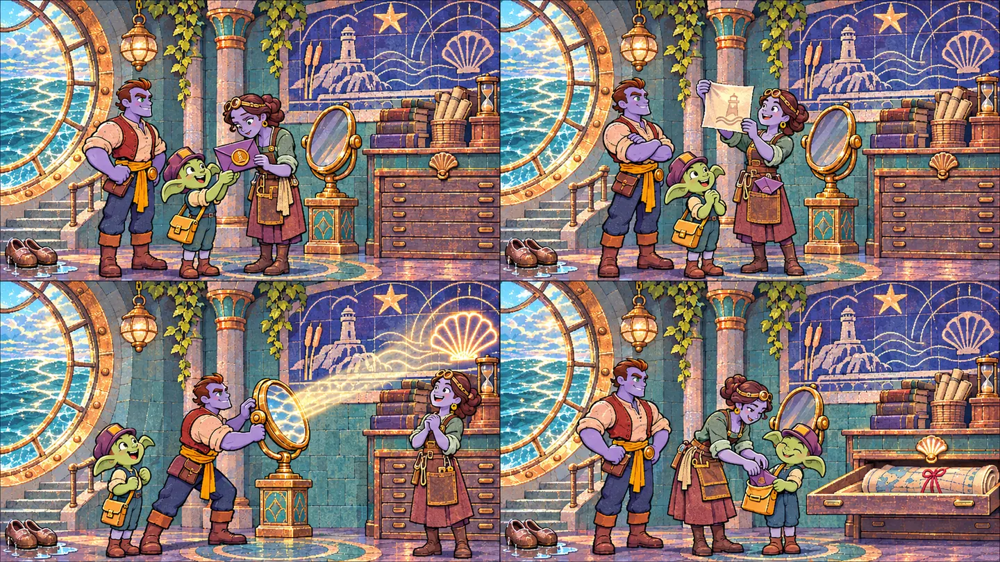
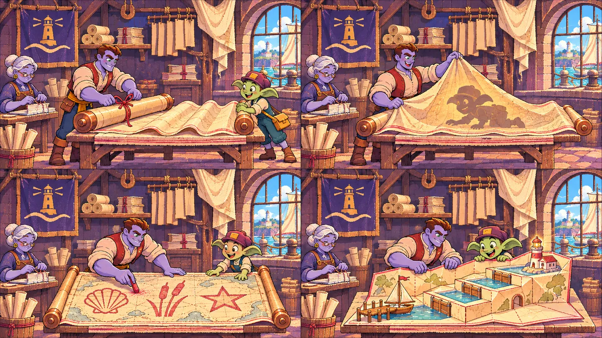
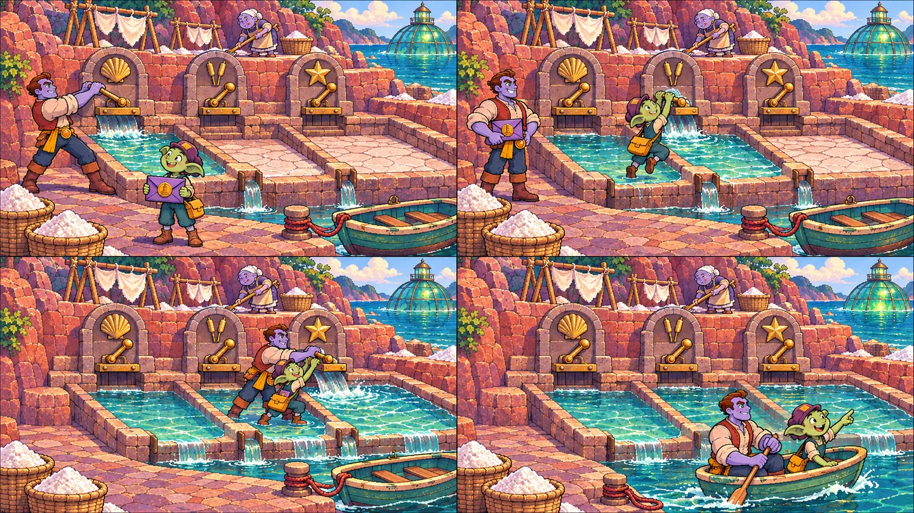
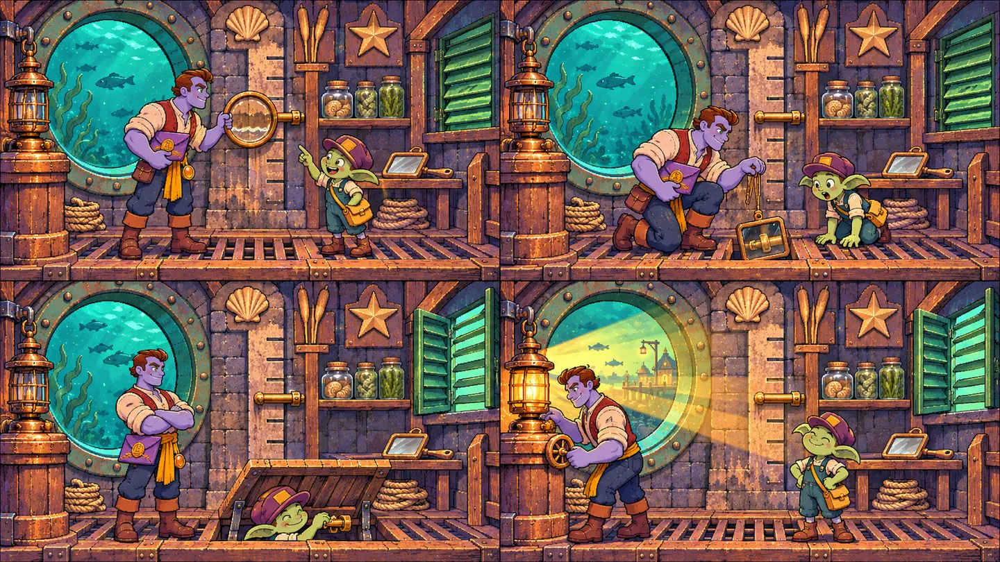
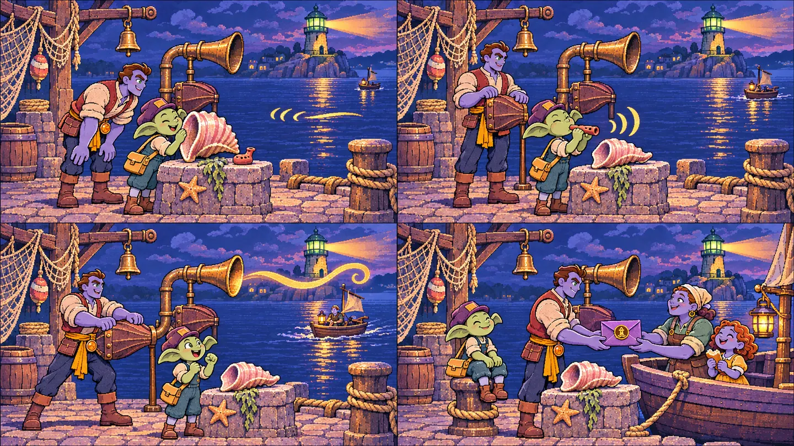

# Маяк под волной

Вторая глава приключения Гуманоида и почтальона Шпуля. Действия 21–40 начинаются с фиолетового письма на Нижнем острове. Адресат — мама девочки, которая ведёт последнюю лодку домой. Местные солевары закрыли шлюзы, а зелёный фонарь старого маяка погас. Принцесса-часовщица помогает прочесть водяной знак и продолжает работу в замке.

[Играть](https://tvijo-crew-academy.be9ava.chatgpt.site/tide-beacon.html) · [Сценарий действий 1–20](./lower-island-mail.md)

Один лист на комнату, четыре микросцены на листе в порядке чтения. В игре на компьютере или телефоне в альбомной ориентации показывается по одному широкому кадру. У обеих глав свои сохранения в этом браузере.

Из референсов взяты принципы композиции и головоломок. Пространство и герои Tvijo оригинальны. Карта становится объёмным причалом, отражение открывает защёлку, а сигналы двух разных инструментов складываются в семейный позывной.

## 6. Зал двух отливов

Шпуль принёс в замок письмо с печатью подводного маяка. Темнеет, а последняя лодка до сих пор в море.

| Действие | Отклик мира |
|---|---|
| 21. Показать письмо принцессе | Принцесса узнала печать. «Мама девочки ведёт последнюю лодку. На берегу для неё должен гореть маяк». |
| 22. Поднести лист к окну | На свету проступил водяной знак. Волна на листе оборвана посередине, словно у неё есть вторая половина. |
| 23. Совместить водяной знак с росписью поворотным зеркалом | Отражение сомкнулось с узором старой росписи. На стене засветилась маленькая перламутровая раковина. |
| 24. Отжать перламутровую защёлку и получить карту | Шпуль нажал на раковину. В ящике лежала свёрнутая карта. Принцесса вернула ему письмо: «Отдашь маме прямо в руки». |

## 7. Бумажный берег

Переплётчица когда-то чинила карты лоцманам. На её столе берег умещается между двумя медными валиками.

| Действие | Отклик мира |
|---|---|
| 25. Раскатать карту | Из свёртка выкатилась целая бухта. Бумага выгнулась так высоко, что под ней поместился бы почтальон. |
| 26. Отправить Шпуля под складку | Шпуль полез под лист. Сверху медленно проплыл кончик его колпака и три раза стукнулся о выступы. |
| 27. Провести мелком по выступам | Мелок зацепил три выступа. Слева направо вышли раковина, камыш и звезда. Шпуль запомнил порядок. |
| 28. Сложить объёмный причал по старым сгибам | Старые сгибы встали домиком. Среди бумажных волн появились три шлюза и короткий причал к маяку. |

## 8. Соляные шлюзы

У солеваров три чаши и три затвора. На сухом дне лежит почтовый челнок. Поднять его может только вода.

| Действие | Отклик мира |
|---|---|
| 29. Открыть затвор с раковиной | Вода пошла в первую чашу. На сухой стенке осталась белая соляная кайма. |
| 30. Открыть затвор с камышом | Камышовый затвор поднялся. Вода перескочила через порог, и челнок слегка качнулся. |
| 31. Открыть затвор со звездой | Уровни сравнялись. Челнок всплыл так резко, что Шпуль сел прямо на собственную сумку. |
| 32. Снять швартов и отплыть к маяку | Красный швартов лёг на причал. Челнок проскользнул в сухую служебную галерею под зелёным фонарём. |

## 9. Фонарная под водой

Внутри маяка сухо. За стеклом ходят рыбы, а под настилом спрятался привод ставней. До потопа смотритель доставал его с мостков.

| Действие | Отклик мира |
|---|---|
| 33. Сверить ватерлинию сквозь линзу времени | Линза показала старую ватерлинию. На той высоте в стене осталась глубокая медная риска. |
| 34. Опустить зеркало к риске | В опущенном зеркале появилась бронзовая защёлка. Оказывается, к ней можно подлезть с сухой стороны. |
| 35. Поручить Шпулю отжать нижнюю защёлку | Шпуль отжал бронзовый язычок. Над его головой развернулись зелёные ставни. |
| 36. Поднять фитиль и направить свет к причалу | Огонь поднялся над оправой. Сквозь морское стекло лёг золотой луч, и на причале ожили тени от сетей. |

## 10. Причал двух голосов

Луч нашёл лодку. Но мама девочки ждёт знакомый сигнал: у каждого причала свой голос.

| Действие | Отклик мира |
|---|---|
| 37. Прислушаться к раковине | Из раковины доносятся два коротких сигнала и один долгий. Тот самый семейный позывной, что слышали у машины времени. |
| 38. Ответить двумя свистками | Шпуль дважды дунул в глиняную свистульку. Над водой пробежали два коротких круга. |
| 39. Дать одну длинную ноту мехами рожка | Гуманоид сжал мехи. Долгая нота прошла по воде, и лодка свернула к освещённым мосткам. |
| 40. Передать письмо лодочнице | Мама развернула письмо. Дочка уже тянула ей хлебную корку: «Я тебе самую хрустящую оставила». Шпуль впервые закрыл почтовую сумку совсем пустой. |

## Загадки и возвращение

Порядок шлюзов отпечатан на карте. Игрок может снова открыть её у затворов. При ошибке вода уходит в боковой канал, достигнутый уровень сохраняется. Сигнал лодки — два коротких, один длинный. По желанию включается звук. На экране остаются длины сигналов; их можно повторить, точный тайминг не требуется.

Из меню маршрута можно вернуться в пройденную комнату, переиграть её или открыть первую главу. Полный путь мышью и клавиатурой проходит те же действия, что касания по ромбам и подписанным кнопкам.

Файлы второй главы: web/tide-beacon.html, web/mailrun/tides.js, пять тематических WebP. Общие правила перехода и сохранения находятся в web/mailrun/progress.js.
